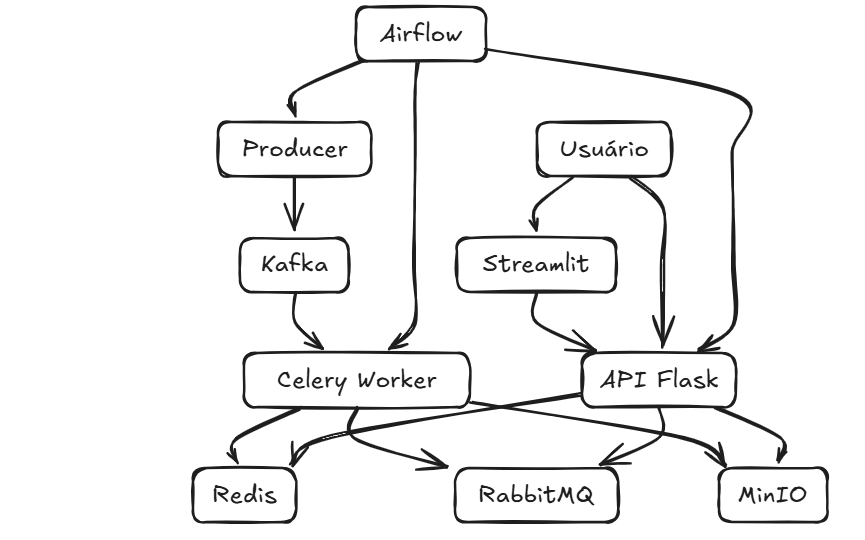

# Simulação de Pipeline: Ingestão e Processamento de Dados com Airflow, Kafka, Spark e MinIO

## 1. Objetivo

Você deverá executar um pipeline simples de engenharia de dados usando os ambientes Docker já fornecidos nas pastas do repositório.

O pipeline deve usar:

- **Kafka** para receber os dados do dataset;
- **Airflow** para organizar a execução das etapas;
- **Spark / PySpark** para processar os dados;
- **MinIO** para armazenar o resultado;
- **Parquet** como formato final dos dados processados.

O fluxo esperado é que o Airflow orquestre o fluxo:

```text
MinIO (CSV) -> Kafka -> Spark -> MinIO (Parquet)
```

---

## 2. Arquiteturas

Cada ferramenta já possui sua própria pasta e seu próprio `docker-compose.yml`.

Você deve subir cada ambiente separadamente, mantendo todos os containers na mesma rede Docker.

A rede usada será:

```text
mybridge
```

---

## 3. Criar a rede Docker

Antes de subir os containers, execute:

```bash
docker network create mybridge || true
```

Esse comando cria a rede `mybridge`.

Caso ela já exista, o erro pode ser ignorado.

---

## 4. Subir o MinIO

Entre na pasta do MinIO:

```bash
cd minio
```

Suba o ambiente:

```bash
docker compose up -d
```

Acesse o console do MinIO:

```text
http://localhost:9001
```

Credenciais:

```text
Usuário: minioadmin
Senha: minioadmin
```

Crie um bucket chamado:

```text
air-quality
```

---

## 5. Subir o Kafka

Volte para a raiz do repositório e entre na pasta do Kafka:

```bash
cd ../kafka
```

Suba o ambiente:

```bash
docker compose up -d
```

Acesse o Kafka UI:

```text
http://localhost:8083
```

Crie o tópico:

```text
sensor_raw
```

Configuração mínima:

```text
Partitions: 1
Replication Factor: 1
```

---

## 6. Subir o Spark

Volte para a raiz do repositório e entre na pasta do Spark:

```bash
cd ../spark
```

Suba o ambiente:

```bash
docker compose up -d --build
```

Acesse o Jupyter do container Spark, se necessário:

```text
http://localhost:8889
```

O Spark será usado para ler dados do Kafka, processar os registros e gravar o resultado no MinIO.

---

## 7. Subir o Airflow

Volte para a raiz do repositório e entre na pasta do Airflow:

```bash
cd ../airflow
```

Execute o script de configuração:

```bash
chmod +x *.sh
./pre-setup.sh
./post-setup.sh
```

Depois acesse o Airflow:

```text
http://localhost:8080
```

Credenciais:

```text
Usuário: admin
Senha: admin
```

---

## 8. Conferir a comunicação entre os containers

Todos os serviços devem estar na rede `mybridge`.

Verifique com:

```bash
docker network inspect mybridge
```

Os containers de Kafka, Spark, MinIO e Airflow devem aparecer nessa rede.

Dentro dos containers, os serviços devem ser acessados pelos nomes:

```text
Kafka: kafka1:9092
Kafka alternativo: kafka1:9092,kafka2:9093
MinIO: http://minio:9000
Bucket: air-quality
Tópico Kafka: sensor_raw
```

---

## 9. Criar o Producer Kafka

Crie um script Python para ler o dataset `airquality.csv` e enviar os registros para o tópico Kafka `sensor_raw`.

O Producer deve:

1. ler o arquivo CSV;
2. transformar cada linha em JSON;
3. enviar cada mensagem para o tópico Kafka.

Exemplo de mensagem esperada:

```json
{
  "Date": "10/03/2004",
  "Time": "18.00.00",
  "CO": "2.6",
  "NO2": "113.0",
  "Temperature": "13.6",
  "Relative_Humidity": "48.9",
  "Absolute_Humidity": "0.7578"
}
```

O Producer deve usar o endereço:

```text
kafka1:9092
```

---

## 10. Criar o processamento Spark

Crie um job PySpark para ler os dados do Kafka.

O job Spark deve:

1. conectar no Kafka;
2. ler as mensagens do tópico `sensor_raw`;
3. interpretar o conteúdo JSON;
4. converter os campos numéricos;
5. criar uma coluna de data/hora a partir de `Date` e `Time`;
6. gravar o resultado no MinIO em formato Parquet.

O caminho de saída deve ser:

```text
s3a://air-quality/processed/airquality/
```

O Spark deve usar o MinIO em:

```text
http://minio:9000
```

Credenciais:

```text
Access Key: minioadmin
Secret Key: minioadmin
```

---

## 11. Criar a DAG no Airflow

Crie uma DAG no Airflow para organizar a execução do pipeline.

A DAG deve ter, no mínimo, as seguintes tarefas:

```text
create_kafka_topic
        |
        v
run_producer
        |
        v
run_spark_job
        |
        v
validate_output
```

A DAG deve executar manualmente pela interface do Airflow.
A DAG não precisa rodar automaticamente por agendamento.
---

## 12. Validação no MinIO

Depois da execução, acesse:

```text
http://localhost:9001
```

Entre no bucket:

```text
air-quality
```

Verifique se existe a pasta:

```text
processed/airquality/
```

Dentro dela devem existir arquivos em formato Parquet.

---

## 13. Resultado esperado

Ao final, o pipeline deve demonstrar o seguinte fluxo:

```text
AirQuality CSV
      |
      v
Kafka topic: sensor_raw
      |
      v
Spark / PySpark
      |
      v
MinIO bucket: air-quality
      |
      v
Parquet em processed/airquality/
```

---

## 14. O que deve ser entregue

Entregue um arquivo `.zip` contendo:

1. o código do Producer Kafka;
2. o código do job PySpark;
3. o código da DAG do Airflow;
4. prints ou logs demonstrando:
   - containers em execução;
   - tópico `sensor_raw` criado;
   - DAG executada no Airflow;
   - arquivos Parquet gravados no MinIO.

---

## 15. Leitura em Batch

Nesta atividade, o Spark deve fazer leitura em lote dos dados disponíveis no Kafka.

Use:

```python
spark.read.format("kafka")
```

---


<!--


## 1. Visão Geral 

Nesta atividade, você deve implementar um pipeline completo de ingestão, processamento, armazenamento e visualização de dados. O dataset utilizado será o Air Quality, e o fluxo de dados segue o padrão definido abaixo:

1. O Producer Kafka lê o dataset Air Quality e envia os dados para o tópico `sensor_raw`.
2. O Consumer Celery processa os dados recebidos:
- Armazena em Redis como cache em tempo real.
- Identifica alertas críticos (ex: `CO > 10`, `NO2 > 200`) e envia para o RabbitMQ.
- Armazena os dados brutos e processados no MinIO.

3. O Streamlit lê os dados do Redis e exibe o status dos sensores em tempo real.
4. O MinIO mantém os dados históricos, funcionando como Data Lake.

Suba os contêineres do Kafka, Redis, RabbitMQ, Celery, Minio e Streamlit, garantindo que estejam se comunicando pela rede (ex: `mybridge`) e implemente o desafio! 

<!--
## Preparação do Ambiente

1. 
2. 

### Producer  

```python
import pandas as pd
from kafka import KafkaProducer
import json
import time

# Configurar o Producer Kafka
producer = KafkaProducer(
    bootstrap_servers='localhost:9092',
    value_serializer=lambda v: json.dumps(v).encode('utf-8')
)

# Carregar o dataset
data = pd.read_csv('AirQualityUCI_Treated.csv', sep=';')

# Enviar os dados para o tópico 'sensor_raw'
for index, row in data.iterrows():
    message = {
        'date': row['Date'],
        'time': row['Time'],
        'CO': row['CO'],
        'NO2': row['NO2'],
        'Temperature': row['Temperature'],
        'Relative_Humidity': row['Relative_Humidity'],
        'Absolute_Humidity': row['Absolute_Humidity']
    }
    producer.send('sensor_raw', value=message)
    print(f"Enviado: {message}")
    time.sleep(0.5)

print("Ingestão concluída.")
```

### Consumer 

```python
from kafka import KafkaConsumer
from celery import Celery
import redis
import json
import boto3

# Configurar o Redis
redis_client = redis.StrictRedis(host='localhost', port=6379, db=0)

# Configurar o Celery
app = Celery('tasks', broker='redis://localhost:6379/0')

# Configurar o Kafka Consumer
consumer = KafkaConsumer(
    'sensor_raw',
    bootstrap_servers='localhost:9092',
    value_deserializer=lambda x: json.loads(x.decode('utf-8'))
)

# Configurar o MinIO
s3 = boto3.client(
    's3',
    endpoint_url='http://localhost:9000',
    aws_access_key_id='minioadmin',
    aws_secret_access_key='minioadmin'
)

@app.task
def process_data(data):
    redis_client.hset(f"sensor_{data['date']}_{data['time']}", mapping=data)

    if data['CO'] > 10 or data['NO2'] > 200:
        print("Alerta Crítico! CO ou NO2 acima do limite.")

    s3.put_object(Bucket='air-quality', Key=f"{data['date']}_{data['time']}.json", Body=json.dumps(data))

# Consumir mensagens do Kafka
for message in consumer:
    process_data.delay(message.value)
```


## 2. Planejamento da Implementação

O pipeline proposto pode ser organizado e operacionalizado por diferentes formas. No contexto de engenharia de dados moderna, com o que vimos até aqui, sugerimos as seguintes abordagens que podem ser inclusive combinadas: 

**Abordagem A - API Flask como Serviço de Integração**: Nesta abordagem, pode ser desenvolvida uma API REST com Flask, cuja função é atuar como uma camada de integração entre os serviços do pipeline. Ela expõe endpoints HTTP que permitem acessar os dados de cache no Redis, os dados históricos armazenados no MinIO e os alertas gerados na fila do RabbitMQ. A API Flask funciona como um middleware, simplificando o acesso aos dados e permitindo que aplicações, dashboards (como o Streamlit) ou scripts externos interajam diretamente com o pipeline, sem a necessidade de se conectar individualmente a cada serviço backend. Essa abordagem permite que qualquer sistema — incluindo automações em Shell Script (`.sh` e comandos `curl`), aplicações Python, dashboards ou outros microserviços — acesse os dados de forma unificada, padronizada e independente da complexidade da infraestrutura interna. 

**Abordagem B — Airflow como Orquestrador do Pipeline**: esta abordagem, utilizamos o Apache Airflow como ferramenta de orquestração para organizar, coordenar e monitorar a execução do pipeline de dados. O Airflow não substitui nenhum dos serviços do pipeline — como Kafka, Redis, RabbitMQ, MinIO ou Streamlit — mas assume a responsabilidade de sequenciar as etapas, controlar as dependências e garantir que cada tarefa ocorra na ordem correta e de forma controlada.

Cada etapa do pipeline é modelada como uma tarefa (Task) dentro de uma DAG (Directed Acyclic Graph), permitindo definir claramente as dependências, os critérios de execução, os pontos de falha e as estratégias de reprocessamento.

O Apache Airflow é uma ferramenta de orquestração de workflows em lote (batch). Seu propósito não é o processamento em tempo real, mas sim a execução sequencial, controlada e auditável de tarefas, definindo ordem, dependências e agendamentos.

Apesar de não ser uma solução de streaming no sentido estrito, no contexto deste desafio podemos utilizar o Airflow para simular o pipeline completo de forma estruturada e controlada, organizando as seguintes etapas:

- Ingestão de dados (leitura do CSV no MinIO e envio para Kafka);
- Processamento dos dados (consumo do Kafka);
- Cache dos dados em Redis;
- Geração de alertas críticos no RabbitMQ;
- Armazenamento histórico dos dados no MinIO (Data Lake). 

Importante destacar que a utilização do Airflow não invalida nem substitui a API Flask desenvolvida na Abordagem A. Pelo contrário, o Airflow pode consumir a API Flask como parte de suas tarefas, seja para:

- Ler dados expostos pela API, consultando Redis, MinIO ou RabbitMQ via HTTP/REST;
- Acionar operações específicas disponibilizadas pela API, como gatilhos externos ou leituras unificadas;
- Integrar o pipeline com outras aplicações externas que utilizem a API, mantendo uma interface padrão de comunicação entre sistemas.

Essa integração reforça uma arquitetura flexível e robusta, onde o Airflow cuida da orquestração e controle operacional dos pipelines, enquanto a API Flask fornece uma camada de abstração, acesso e integração externa, tanto para consumo humano (dashboards, aplicações) quanto para consumo máquina (outros serviços, automações ou scripts):



Para garantir uma melhor assimilação dos conceitos, organização do raciocínio e avanço progressivo no desenvolvimento do pipeline, o desafio deve ser estruturado em etapas graduais, onde cada fase representa um componente funcional da arquitetura. 

### Fase 1 — Ingestão de Dados (Kafka e Producer)

- Objetivo: Implementar o producer que lê o CSV (AirQuality) e envia os dados para o tópico sensor_raw no Kafka.
- Critério de Sucesso: Mensagens corretamente publicadas no tópico Kafka. 

### Fase 2 — Consumidor e Cache (Celery e Redis)

- Objetivo: Consumir as mensagens do tópico Kafka, processar os dados e armazenar em Redis como cache.
- Critério de Sucesso: Dados armazenados corretamente no Redis, verificados por meio de redis-cli ou scripts Python.

### Fase 3 — Armazenamento Histórico (MinIO)

- Objetivo: Persistir os dados processados no MinIO, funcionando como data lake.
- Critério de Sucesso: Arquivos JSON devidamente armazenados no bucket do MinIO.

### Fase 4 — Alertas (RabbitMQ)

- Objetivo: Implementar geração de alertas críticos (ex.: CO > 10 ou NO2 > 200) enviados para uma fila no RabbitMQ.
- Critério de Sucesso: Mensagens de alerta corretamente publicadas e visíveis na fila RabbitMQ.

### Fase 5 — API Flask (Integração e Unificação)

- Objetivo: Desenvolver uma API REST com Flask que unifica o acesso aos dados provenientes de Redis, MinIO e RabbitMQ.
- Critério de Sucesso: Endpoints operacionais, retornando dados corretamente de cada serviço backend.

### Fase 6 — Airflow (Orquestração das Tarefas)
- Objetivo: Organizar todo o pipeline em uma DAG no Airflow, controlando as dependências e a execução sequencial das etapas.
- Citério de Sucesso: DAG funcional, executando corretamente as etapas de ingestão, processamento, armazenamento, geração de alertas e atualização do cache.

### Fase 7 — Visualização (Streamlit)

- Objetivo: Criar um dashboard com Streamlit que consome dados do Redis em tempo real.
- Critério de Sucesso: Dashboard funcionando, exibindo status dos sensores com dados atualizados.

## 3. Dicas de Implementação 

### Exemplo de API Flask

```python
from flask import Flask, jsonify
import redis
import boto3
import json
import pika

app = Flask(__name__)

# Configuração dos serviços
REDIS_HOST = 'redis'
RABBITMQ_HOST = 'rabbitmq'
MINIO_ENDPOINT = 'http://minio:9000'
MINIO_ACCESS_KEY = 'minioadmin'
MINIO_SECRET_KEY = 'minioadmin'
BUCKET = 'air-quality'

# Endpoint para dados do Redis
@app.route('/api/cache/<key>', methods=['GET'])
def get_cache(key):
    r = redis.StrictRedis(host=REDIS_HOST, port=6379, db=0)
    data = r.hgetall(key)
    if not data:
        return jsonify({'error': 'Key not found'}), 404
    return jsonify({k.decode(): v.decode() for k, v in data.items()})

# Endpoint para dados históricos do MinIO
@app.route('/api/history/<filename>', methods=['GET'])
def get_history(filename):
    s3 = boto3.client(
        's3',
        endpoint_url=MINIO_ENDPOINT,
        aws_access_key_id=MINIO_ACCESS_KEY,
        aws_secret_access_key=MINIO_SECRET_KEY
    )
    try:
        obj = s3.get_object(Bucket=BUCKET, Key=f"processed/{filename}.json")
        data = json.loads(obj['Body'].read().decode('utf-8'))
        return jsonify(data)
    except Exception as e:
        return jsonify({'error': str(e)}), 404

# Endpoint para alertas no RabbitMQ
@app.route('/api/alerts', methods=['GET'])
def get_alerts():
    try:
        connection = pika.BlockingConnection(pika.ConnectionParameters(host=RABBITMQ_HOST))
        channel = connection.channel()
        channel.queue_declare(queue='sensor_alert')

        method_frame, header_frame, body = channel.basic_get(queue='sensor_alert')
        if method_frame:
            channel.basic_ack(method_frame.delivery_tag)
            connection.close()
            return jsonify({'alert': body.decode()})
        else:
            connection.close()
            return jsonify({'alert': 'No alerts in queue'})
    except Exception as e:
        return jsonify({'error': str(e)})

if __name__ == '__main__':
    app.run(host='0.0.0.0', port=5000)
```

### Exemplo de DAG do Airflow

Ajuste o código exemplo para organizar o desafio proposto. Integre o código que você já desenvolveu anteriormente. Utilizaremos o `PythonOperator` em conjunto com o `LocalExecutor` para orquestrar as tarefas. Caso necessário, essa implementação poderá ser facilmente migrada para uma arquitetura distribuída utilizando o `CeleryExecutor` posteriormente. 

```python
from airflow import DAG
from airflow.operators.python import PythonOperator
from datetime import datetime, timedelta
from kafka import KafkaProducer, KafkaConsumer
import redis
import json
import pandas as pd
import boto3
import io
import time
import pika


# ================================
# Configurações Globais
# ================================
KAFKA_SERVER = 'kafka:9092'
REDIS_HOST = 'redis'
RABBITMQ_HOST = 'rabbitmq'
MINIO_ENDPOINT = 'http://minio:9000'
MINIO_ACCESS_KEY = 'minioadmin'
MINIO_SECRET_KEY = 'minioadmin'
BUCKET = 'air-quality'


# ================================
# Função 1 – Enviar CSV do MinIO para Kafka
# ================================
def load_csv_to_kafka():
    s3 = boto3.client(
        's3',
        endpoint_url=MINIO_ENDPOINT,
        aws_access_key_id=MINIO_ACCESS_KEY,
        aws_secret_access_key=MINIO_SECRET_KEY
    )

    obj = s3.get_object(Bucket=BUCKET, Key='AirQualityUCI_Treated.csv')
    df = pd.read_csv(io.BytesIO(obj['Body'].read()), sep=';')

    producer = KafkaProducer(
        bootstrap_servers=KAFKA_SERVER,
        value_serializer=lambda v: json.dumps(v).encode('utf-8')
    )

    for _, row in df.iterrows():
        message = {
            'date': row['Date'],
            'time': row['Time'],
            'CO': float(row['CO']),
            'NO2': float(row['NO2']),
            'Temperature': float(row['Temperature']),
            'Relative_Humidity': float(row['Relative_Humidity']),
            'Absolute_Humidity': float(row['Absolute_Humidity'])
        }
        producer.send('sensor_raw', value=message)
        print(f"Enviado ao Kafka: {message}")
        time.sleep(0.2)

    producer.flush()


# ================================
# Função 2 – Consumir dados do Kafka
# ================================
def consume_from_kafka(**context):
    consumer = KafkaConsumer(
        'sensor_raw',
        bootstrap_servers=KAFKA_SERVER,
        value_deserializer=lambda x: json.loads(x.decode('utf-8')),
        auto_offset_reset='earliest',
        enable_auto_commit=True
    )

    data_list = []
    for msg in consumer:
        data = msg.value
        data_list.append(data)

        if len(data_list) >= 100:
            break

    context['ti'].xcom_push(key='sensor_data', value=data_list)


# ================================
# Função 3 – Processar e salvar no Redis e MinIO
# ================================
def process_and_store_to_minio_and_redis(**context):
    data_list = context['ti'].xcom_pull(key='sensor_data', task_ids='consume_from_kafka')

    r = redis.StrictRedis(host=REDIS_HOST, port=6379, db=0)

    s3 = boto3.client(
        's3',
        endpoint_url=MINIO_ENDPOINT,
        aws_access_key_id=MINIO_ACCESS_KEY,
        aws_secret_access_key=MINIO_SECRET_KEY
    )

    buckets = [b['Name'] for b in s3.list_buckets().get('Buckets', [])]
    if BUCKET not in buckets:
        s3.create_bucket(Bucket=BUCKET)

    for data in data_list:
        key = f"sensor:{data['date']}:{data['time']}"
        r.hset(key, mapping=data)

        s3.put_object(
            Bucket=BUCKET,
            Key=f"processed/{data['date']}_{data['time']}.json",
            Body=json.dumps(data)
        )

        print(f"Processado e armazenado: {key}")


# ================================
# Função 4 – Enviar alertas para RabbitMQ
# ================================
def send_alert_to_rabbitmq(**context):
    data_list = context['ti'].xcom_pull(key='sensor_data', task_ids='consume_from_kafka')

    connection = pika.BlockingConnection(pika.ConnectionParameters(host=RABBITMQ_HOST))
    channel = connection.channel()
    channel.queue_declare(queue='sensor_alert')

    for data in data_list:
        if data['CO'] > 10 or data['NO2'] > 200:
            alert = f"ALERTA! {data}"
            channel.basic_publish(exchange='', routing_key='sensor_alert', body=alert)
            print(f"Enviado alerta: {alert}")

    connection.close()


# ================================
# Definição da DAG
# ================================
default_args = {
    'owner': 'admin',
    'retries': 1,
    'retry_delay': timedelta(minutes=1),
}

with DAG(
    dag_id='pipeline_sensor_airflow',
    default_args=default_args,
    description='Pipeline completo com Kafka, Redis, RabbitMQ e MinIO',
    schedule_interval=None,
    start_date=datetime(2024, 1, 1),
    catchup=False,
    tags=['pipeline', 'iot', 'airflow'],
) as dag:

    t1 = PythonOperator(
        task_id='load_csv_to_kafka',
        python_callable=load_csv_to_kafka,
    )

    t2 = PythonOperator(
        task_id='consume_from_kafka',
        python_callable=consume_from_kafka,
    )

    t3 = PythonOperator(
        task_id='process_and_store_to_minio_and_redis',
        python_callable=process_and_store_to_minio_and_redis,
    )

    t4 = PythonOperator(
        task_id='send_alert_to_rabbitmq',
        python_callable=send_alert_to_rabbitmq,
    )

    t1 >> t2 >> [t3, t4]
```
Para solucionar o desafio proposto, optamos por um cenário típico de pipelines de streaming, mas implementado e executado na forma de simulação em modo batch, uma vez que operamos sobre um dataset finito.

Nesta simulação, a utilização de uma API Flask como camada de integração se mostra uma alternativa elegante, funcional e estratégica, pois permite a exposição dos dados processados no pipeline para consumo externo, facilitando a comunicação com dashboards, aplicações e outros sistemas, independentemente da ferramenta de orquestração utilizada.
-->

## Considerações Finais 

O pipeline implementado no Airflow representa uma execução controlada, organizada, auditável e aderente às melhores práticas de engenharia de dados, preservando os princípios de modularidade, escalabilidade e observabilidade.

Os fundamentos aqui praticados estão estruturados dentro de uma arquitetura robusta, que pode ser aproveitada tanto para simulações quanto para cenários de produção, e, posteriormente, evoluída para suportar operações em tempo real, mediante a adoção de ferramentas específicas adicionais, como Apache NiFi, Apache Flink ou Apache Spark Streaming. 


<!--

# Simulação de Pipeline: Ingestão e Processamento de Dados

## 1. Visão Geral 

Nesta atividade, você deve implementar um pipeline completo de ingestão, processamento, armazenamento e visualização de dados. O dataset utilizado será o Air Quality, e o fluxo de dados segue o padrão definido abaixo:

1. O Producer Kafka lê o dataset Air Quality e envia os dados para o tópico `sensor_raw`.
2. O Consumer Celery processa os dados recebidos:
- Armazena em Redis como cache em tempo real.
- Identifica alertas críticos (ex: `CO > 10`, `NO2 > 200`) e envia para o RabbitMQ.
- Armazena os dados brutos e processados no MinIO.

3. O Streamlit lê os dados do Redis e exibe o status dos sensores em tempo real.
4. O MinIO mantém os dados históricos, funcionando como Data Lake.

Suba os contêineres do Kafka, Redis, RabbitMQ, Celery, Minio e Streamlit, garantindo que estejam se comunicando pela rede (ex: `mybridge`) e implemente o desafio! 

<!--
## Preparação do Ambiente

1. 
2. 

### Producer  

```python
import pandas as pd
from kafka import KafkaProducer
import json
import time

# Configurar o Producer Kafka
producer = KafkaProducer(
    bootstrap_servers='localhost:9092',
    value_serializer=lambda v: json.dumps(v).encode('utf-8')
)

# Carregar o dataset
data = pd.read_csv('AirQualityUCI_Treated.csv', sep=';')

# Enviar os dados para o tópico 'sensor_raw'
for index, row in data.iterrows():
    message = {
        'date': row['Date'],
        'time': row['Time'],
        'CO': row['CO'],
        'NO2': row['NO2'],
        'Temperature': row['Temperature'],
        'Relative_Humidity': row['Relative_Humidity'],
        'Absolute_Humidity': row['Absolute_Humidity']
    }
    producer.send('sensor_raw', value=message)
    print(f"Enviado: {message}")
    time.sleep(0.5)

print("Ingestão concluída.")
```

### Consumer 

```python
from kafka import KafkaConsumer
from celery import Celery
import redis
import json
import boto3

# Configurar o Redis
redis_client = redis.StrictRedis(host='localhost', port=6379, db=0)

# Configurar o Celery
app = Celery('tasks', broker='redis://localhost:6379/0')

# Configurar o Kafka Consumer
consumer = KafkaConsumer(
    'sensor_raw',
    bootstrap_servers='localhost:9092',
    value_deserializer=lambda x: json.loads(x.decode('utf-8'))
)

# Configurar o MinIO
s3 = boto3.client(
    's3',
    endpoint_url='http://localhost:9000',
    aws_access_key_id='minioadmin',
    aws_secret_access_key='minioadmin'
)

@app.task
def process_data(data):
    redis_client.hset(f"sensor_{data['date']}_{data['time']}", mapping=data)

    if data['CO'] > 10 or data['NO2'] > 200:
        print("Alerta Crítico! CO ou NO2 acima do limite.")

    s3.put_object(Bucket='air-quality', Key=f"{data['date']}_{data['time']}.json", Body=json.dumps(data))

# Consumir mensagens do Kafka
for message in consumer:
    process_data.delay(message.value)
```

-->

## 2. Planejamento da Implementação

O pipeline proposto pode ser organizado e operacionalizado por diferentes formas. No contexto de engenharia de dados moderna, com o que vimos até aqui, sugerimos as seguintes abordagens que podem ser inclusive combinadas: 

**Abordagem A - API Flask como Serviço de Integração**: Nesta abordagem, pode ser desenvolvida uma API REST com Flask, cuja função é atuar como uma camada de integração entre os serviços do pipeline. Ela expõe endpoints HTTP que permitem acessar os dados de cache no Redis, os dados históricos armazenados no MinIO e os alertas gerados na fila do RabbitMQ. A API Flask funciona como um middleware, simplificando o acesso aos dados e permitindo que aplicações, dashboards (como o Streamlit) ou scripts externos interajam diretamente com o pipeline, sem a necessidade de se conectar individualmente a cada serviço backend. Essa abordagem permite que qualquer sistema — incluindo automações em Shell Script (`.sh` e comandos `curl`), aplicações Python, dashboards ou outros microserviços — acesse os dados de forma unificada, padronizada e independente da complexidade da infraestrutura interna. 

**Abordagem B — Airflow como Orquestrador do Pipeline**: esta abordagem, utilizamos o Apache Airflow como ferramenta de orquestração para organizar, coordenar e monitorar a execução do pipeline de dados. O Airflow não substitui nenhum dos serviços do pipeline — como Kafka, Redis, RabbitMQ, MinIO ou Streamlit — mas assume a responsabilidade de sequenciar as etapas, controlar as dependências e garantir que cada tarefa ocorra na ordem correta e de forma controlada.

Cada etapa do pipeline é modelada como uma tarefa (Task) dentro de uma DAG (Directed Acyclic Graph), permitindo definir claramente as dependências, os critérios de execução, os pontos de falha e as estratégias de reprocessamento.

O Apache Airflow é uma ferramenta de orquestração de workflows em lote (batch). Seu propósito não é o processamento em tempo real, mas sim a execução sequencial, controlada e auditável de tarefas, definindo ordem, dependências e agendamentos.

Apesar de não ser uma solução de streaming no sentido estrito, no contexto deste desafio podemos utilizar o Airflow para simular o pipeline completo de forma estruturada e controlada, organizando as seguintes etapas:

- Ingestão de dados (leitura do CSV no MinIO e envio para Kafka);
- Processamento dos dados (consumo do Kafka);
- Cache dos dados em Redis;
- Geração de alertas críticos no RabbitMQ;
- Armazenamento histórico dos dados no MinIO (Data Lake). 

Importante destacar que a utilização do Airflow não invalida nem substitui a API Flask desenvolvida na Abordagem A. Pelo contrário, o Airflow pode consumir a API Flask como parte de suas tarefas, seja para:

- Ler dados expostos pela API, consultando Redis, MinIO ou RabbitMQ via HTTP/REST;
- Acionar operações específicas disponibilizadas pela API, como gatilhos externos ou leituras unificadas;
- Integrar o pipeline com outras aplicações externas que utilizem a API, mantendo uma interface padrão de comunicação entre sistemas.

Essa integração reforça uma arquitetura flexível e robusta, onde o Airflow cuida da orquestração e controle operacional dos pipelines, enquanto a API Flask fornece uma camada de abstração, acesso e integração externa, tanto para consumo humano (dashboards, aplicações) quanto para consumo máquina (outros serviços, automações ou scripts):


Para garantir uma melhor assimilação dos conceitos, organização do raciocínio e avanço progressivo no desenvolvimento do pipeline, o desafio deve ser estruturado em etapas graduais, onde cada fase representa um componente funcional da arquitetura. 

### Fase 1 — Ingestão de Dados (Kafka e Producer)

- Objetivo: Implementar o producer que lê o CSV (AirQuality) e envia os dados para o tópico sensor_raw no Kafka.
- Critério de Sucesso: Mensagens corretamente publicadas no tópico Kafka. 

### Fase 2 — Consumidor e Cache (Celery e Redis)

- Objetivo: Consumir as mensagens do tópico Kafka, processar os dados e armazenar em Redis como cache.
- Critério de Sucesso: Dados armazenados corretamente no Redis, verificados por meio de redis-cli ou scripts Python.

### Fase 3 — Armazenamento Histórico (MinIO)

- Objetivo: Persistir os dados processados no MinIO, funcionando como data lake.
- Critério de Sucesso: Arquivos JSON devidamente armazenados no bucket do MinIO.

### Fase 4 — Alertas (RabbitMQ)

- Objetivo: Implementar geração de alertas críticos (ex.: CO > 10 ou NO2 > 200) enviados para uma fila no RabbitMQ.
- Critério de Sucesso: Mensagens de alerta corretamente publicadas e visíveis na fila RabbitMQ.

### Fase 5 — API Flask (Integração e Unificação)

- Objetivo: Desenvolver uma API REST com Flask que unifica o acesso aos dados provenientes de Redis, MinIO e RabbitMQ.
- Critério de Sucesso: Endpoints operacionais, retornando dados corretamente de cada serviço backend.

### Fase 6 — Airflow (Orquestração das Tarefas)
- Objetivo: Organizar todo o pipeline em uma DAG no Airflow, controlando as dependências e a execução sequencial das etapas.
- Citério de Sucesso: DAG funcional, executando corretamente as etapas de ingestão, processamento, armazenamento, geração de alertas e atualização do cache.

### Fase 7 — Visualização (Streamlit)

- Objetivo: Criar um dashboard com Streamlit que consome dados do Redis em tempo real.
- Critério de Sucesso: Dashboard funcionando, exibindo status dos sensores com dados atualizados.

## 3. Dicas de Implementação 

### Exemplo de API Flask

```python
from flask import Flask, jsonify
import redis
import boto3
import json
import pika

app = Flask(__name__)

# Configuração dos serviços
REDIS_HOST = 'redis'
RABBITMQ_HOST = 'rabbitmq'
MINIO_ENDPOINT = 'http://minio:9000'
MINIO_ACCESS_KEY = 'minioadmin'
MINIO_SECRET_KEY = 'minioadmin'
BUCKET = 'air-quality'

# Endpoint para dados do Redis
@app.route('/api/cache/<key>', methods=['GET'])
def get_cache(key):
    r = redis.StrictRedis(host=REDIS_HOST, port=6379, db=0)
    data = r.hgetall(key)
    if not data:
        return jsonify({'error': 'Key not found'}), 404
    return jsonify({k.decode(): v.decode() for k, v in data.items()})

# Endpoint para dados históricos do MinIO
@app.route('/api/history/<filename>', methods=['GET'])
def get_history(filename):
    s3 = boto3.client(
        's3',
        endpoint_url=MINIO_ENDPOINT,
        aws_access_key_id=MINIO_ACCESS_KEY,
        aws_secret_access_key=MINIO_SECRET_KEY
    )
    try:
        obj = s3.get_object(Bucket=BUCKET, Key=f"processed/{filename}.json")
        data = json.loads(obj['Body'].read().decode('utf-8'))
        return jsonify(data)
    except Exception as e:
        return jsonify({'error': str(e)}), 404

# Endpoint para alertas no RabbitMQ
@app.route('/api/alerts', methods=['GET'])
def get_alerts():
    try:
        connection = pika.BlockingConnection(pika.ConnectionParameters(host=RABBITMQ_HOST))
        channel = connection.channel()
        channel.queue_declare(queue='sensor_alert')

        method_frame, header_frame, body = channel.basic_get(queue='sensor_alert')
        if method_frame:
            channel.basic_ack(method_frame.delivery_tag)
            connection.close()
            return jsonify({'alert': body.decode()})
        else:
            connection.close()
            return jsonify({'alert': 'No alerts in queue'})
    except Exception as e:
        return jsonify({'error': str(e)})

if __name__ == '__main__':
    app.run(host='0.0.0.0', port=5000)
```

### Exemplo de DAG do Airflow

Ajuste o código exemplo para organizar o desafio proposto. Integre o código que você já desenvolveu anteriormente. Utilizaremos o `PythonOperator` em conjunto com o `LocalExecutor` para orquestrar as tarefas. Caso necessário, essa implementação poderá ser facilmente migrada para uma arquitetura distribuída utilizando o `CeleryExecutor` posteriormente. 

```python
from airflow import DAG
from airflow.operators.python import PythonOperator
from datetime import datetime, timedelta
from kafka import KafkaProducer, KafkaConsumer
import redis
import json
import pandas as pd
import boto3
import io
import time
import pika


# ================================
# Configurações Globais
# ================================
KAFKA_SERVER = 'kafka:9092'
REDIS_HOST = 'redis'
RABBITMQ_HOST = 'rabbitmq'
MINIO_ENDPOINT = 'http://minio:9000'
MINIO_ACCESS_KEY = 'minioadmin'
MINIO_SECRET_KEY = 'minioadmin'
BUCKET = 'air-quality'


# ================================
# Função 1 – Enviar CSV do MinIO para Kafka
# ================================
def load_csv_to_kafka():
    s3 = boto3.client(
        's3',
        endpoint_url=MINIO_ENDPOINT,
        aws_access_key_id=MINIO_ACCESS_KEY,
        aws_secret_access_key=MINIO_SECRET_KEY
    )

    obj = s3.get_object(Bucket=BUCKET, Key='AirQualityUCI_Treated.csv')
    df = pd.read_csv(io.BytesIO(obj['Body'].read()), sep=';')

    producer = KafkaProducer(
        bootstrap_servers=KAFKA_SERVER,
        value_serializer=lambda v: json.dumps(v).encode('utf-8')
    )

    for _, row in df.iterrows():
        message = {
            'date': row['Date'],
            'time': row['Time'],
            'CO': float(row['CO']),
            'NO2': float(row['NO2']),
            'Temperature': float(row['Temperature']),
            'Relative_Humidity': float(row['Relative_Humidity']),
            'Absolute_Humidity': float(row['Absolute_Humidity'])
        }
        producer.send('sensor_raw', value=message)
        print(f"Enviado ao Kafka: {message}")
        time.sleep(0.2)

    producer.flush()


# ================================
# Função 2 – Consumir dados do Kafka
# ================================
def consume_from_kafka(**context):
    consumer = KafkaConsumer(
        'sensor_raw',
        bootstrap_servers=KAFKA_SERVER,
        value_deserializer=lambda x: json.loads(x.decode('utf-8')),
        auto_offset_reset='earliest',
        enable_auto_commit=True
    )

    data_list = []
    for msg in consumer:
        data = msg.value
        data_list.append(data)

        if len(data_list) >= 100:
            break

    context['ti'].xcom_push(key='sensor_data', value=data_list)


# ================================
# Função 3 – Processar e salvar no Redis e MinIO
# ================================
def process_and_store_to_minio_and_redis(**context):
    data_list = context['ti'].xcom_pull(key='sensor_data', task_ids='consume_from_kafka')

    r = redis.StrictRedis(host=REDIS_HOST, port=6379, db=0)

    s3 = boto3.client(
        's3',
        endpoint_url=MINIO_ENDPOINT,
        aws_access_key_id=MINIO_ACCESS_KEY,
        aws_secret_access_key=MINIO_SECRET_KEY
    )

    buckets = [b['Name'] for b in s3.list_buckets().get('Buckets', [])]
    if BUCKET not in buckets:
        s3.create_bucket(Bucket=BUCKET)

    for data in data_list:
        key = f"sensor:{data['date']}:{data['time']}"
        r.hset(key, mapping=data)

        s3.put_object(
            Bucket=BUCKET,
            Key=f"processed/{data['date']}_{data['time']}.json",
            Body=json.dumps(data)
        )

        print(f"Processado e armazenado: {key}")


# ================================
# Função 4 – Enviar alertas para RabbitMQ
# ================================
def send_alert_to_rabbitmq(**context):
    data_list = context['ti'].xcom_pull(key='sensor_data', task_ids='consume_from_kafka')

    connection = pika.BlockingConnection(pika.ConnectionParameters(host=RABBITMQ_HOST))
    channel = connection.channel()
    channel.queue_declare(queue='sensor_alert')

    for data in data_list:
        if data['CO'] > 10 or data['NO2'] > 200:
            alert = f"ALERTA! {data}"
            channel.basic_publish(exchange='', routing_key='sensor_alert', body=alert)
            print(f"Enviado alerta: {alert}")

    connection.close()


# ================================
# Definição da DAG
# ================================
default_args = {
    'owner': 'admin',
    'retries': 1,
    'retry_delay': timedelta(minutes=1),
}

with DAG(
    dag_id='pipeline_sensor_airflow',
    default_args=default_args,
    description='Pipeline completo com Kafka, Redis, RabbitMQ e MinIO',
    schedule_interval=None,
    start_date=datetime(2024, 1, 1),
    catchup=False,
    tags=['pipeline', 'iot', 'airflow'],
) as dag:

    t1 = PythonOperator(
        task_id='load_csv_to_kafka',
        python_callable=load_csv_to_kafka,
    )

    t2 = PythonOperator(
        task_id='consume_from_kafka',
        python_callable=consume_from_kafka,
    )

    t3 = PythonOperator(
        task_id='process_and_store_to_minio_and_redis',
        python_callable=process_and_store_to_minio_and_redis,
    )

    t4 = PythonOperator(
        task_id='send_alert_to_rabbitmq',
        python_callable=send_alert_to_rabbitmq,
    )

    t1 >> t2 >> [t3, t4]
```

## Considerações Finais 

Para solucionar o desafio proposto, optamos por um cenário típico de pipelines de streaming, implementado e executado na forma de simulação em modo batch, uma vez que operamos sobre um dataset finito.

Nesta simulação, a utilização de uma API Flask como camada de integração se mostra uma alternativa elegante, funcional e estratégica, pois permite a exposição dos dados processados no pipeline para consumo externo, facilitando a comunicação com dashboards, aplicações e outros sistemas, independentemente da ferramenta de orquestração utilizada.

Por sua vez, o pipeline implementado no Airflow representa uma execução controlada, organizada, auditável e aderente às melhores práticas de engenharia de dados, preservando os princípios de modularidade, escalabilidade e observabilidade.

Os fundamentos aqui praticados — ingestão, processamento, armazenamento, geração de alertas, cache e integração — estão estruturados dentro de uma arquitetura robusta, que pode ser aproveitada tanto para simulações quanto para cenários de produção, e, posteriormente, evoluída para suportar operações em tempo real, mediante a adoção de ferramentas específicas adicionais, como Apache NiFi, Apache Flink ou Apache Spark Streaming, que serão apresentadas ao longo do curso. 

-->
